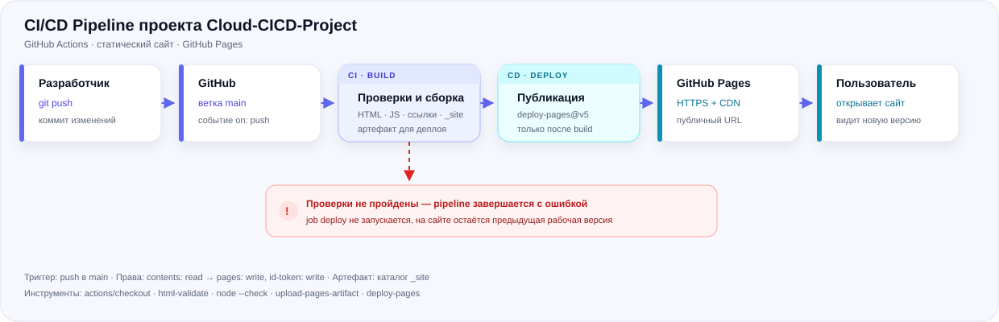
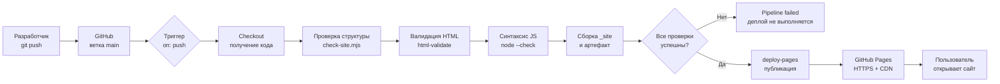
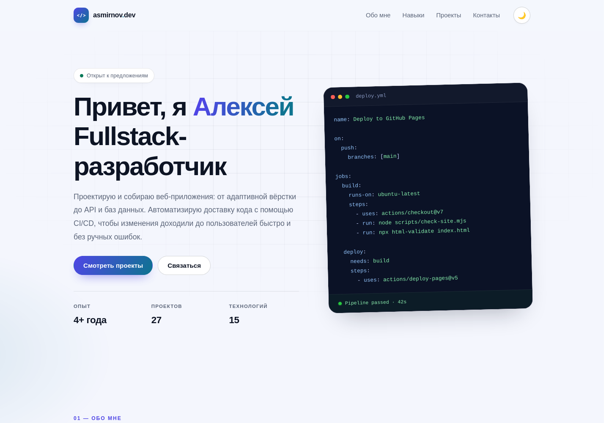
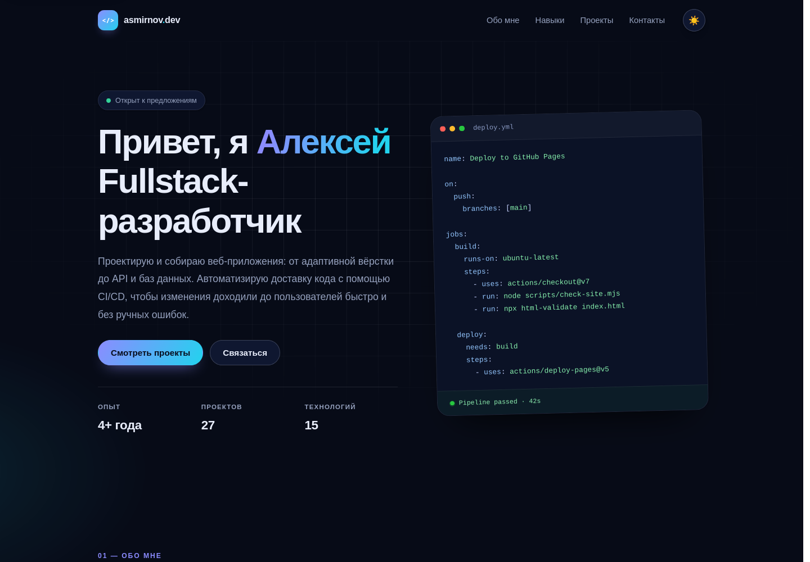
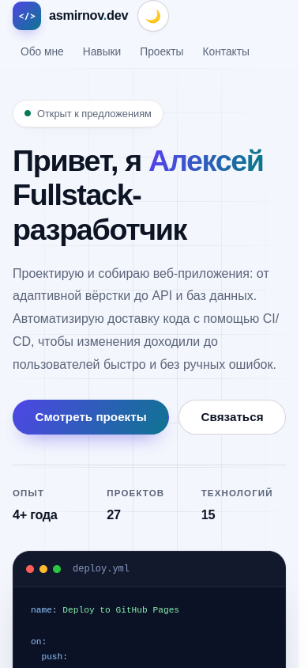

# Отчёт по практической работе № 7

**Тема:** Автоматизация CI/CD для облачных веб-приложений

**Выполнил(а):** _ФИО, группа_

**Дата:** 13.11.2026

**Репозиторий:** `https://github.com/<username>/Cloud-CICD-Project`

**Опубликованный сайт:** `https://<username>.github.io/Cloud-CICD-Project/`

> Ссылки станут активными после создания репозитория и первой успешной публикации.
> Порядок действий приведён в разделе 2.3.

---

## Краткое резюме работы

Разработан статический сайт-портфолио IT-специалиста (`index.html`, `style.css`,
`script.js`, `favicon.svg`). Для проекта настроен CI/CD-пайплайн
`.github/workflows/deploy.yml`: при каждом push в ветку `main` GitHub Actions
проверяет структуру и локальные ссылки, синтаксис JavaScript, валидность HTML,
собирает артефакт и публикует его на GitHub Pages. Публикация выполняется только
после успешного прохождения всех проверок.

Локально проект проверен теми же командами, что и в CI:

| Проверка | Команда | Результат |
|---|---|---|
| Структура и ссылки | `node scripts/check-site.mjs` | 28 проверок, ошибок нет |
| Синтаксис JS | `node --check script.js` | ошибок нет |
| Валидация HTML | `npx --yes html-validate@11.21.1 index.html` | замечаний нет |

---

# Часть 1. Теоретическая

## 1. Что такое CI/CD и для чего используется данная технология?

**CI/CD** — это набор практик и инструментов, которые автоматизируют путь
изменения кода от коммита до работающего приложения. Аббревиатура раскрывается
как **Continuous Integration** (непрерывная интеграция) и **Continuous
Delivery / Continuous Deployment** (непрерывная доставка / непрерывное
развёртывание).

Технология используется, чтобы:

- чаще и безопаснее объединять изменения разных разработчиков в общую ветку;
- автоматически собирать проект и запускать тесты после каждого изменения;
- раньше находить ошибки и дешевле их исправлять;
- выпускать новые версии предсказуемо, по одному и тому же сценарию;
- уменьшить количество ручных операций и связанных с ними ошибок;
- быстро откатываться к предыдущей рабочей версии;
- получать объективную информацию о качестве кода и скорости доставки.

CI/CD — это не один инструмент, а процесс. Его основой обычно являются
система контроля версий (Git), платформа автоматизации (GitHub Actions,
GitLab CI, Jenkins) и инфраструктура, на которую выполняется развёртывание
(сервер, контейнеры, облако, GitHub Pages).

## 2. В чём разница между Continuous Integration, Continuous Delivery и Continuous Deployment?

| Практика | Что автоматизируется | Когда изменение попадает в production | Степень контроля |
|---|---|---|---|
| **Continuous Integration (CI)** | Слияние изменений в общую ветку, сборка и автоматические тесты после каждого push/PR | Ещё не попадает: проверяется только качество кода | Полный контроль разработчика над веткой |
| **Continuous Delivery (CD)** | Всё то же, что в CI, плюс сборка готового релизного артефакта и автоматическое развёртывание в staging/test | В production — **вручную**, по кнопке или после согласования | Высокий: релиз всегда готов, но решение о выпуске принимает человек |
| **Continuous Deployment (CD)** | Всё то же, что в Delivery, плюс автоматическое развёртывание в production после успешных проверок | Автоматически, сразу после прохождения pipeline | Низкий: требуется зрелое тестирование, мониторинг и быстрый откат |

Ключевая разница между Delivery и Deployment — **кто принимает решение
о выпуске в production**: человек (Delivery) или автоматика (Deployment).
Continuous Integration — это фундамент: без надёжных сборок и тестов
ни Delivery, ни Deployment невозможны.

## 3. Что такое CI/CD Pipeline?

**CI/CD Pipeline** — это упорядоченная последовательность автоматических
этапов, которая запускается определённым событием (push, pull request,
тег, расписание) и доводит изменение от исходного кода до работающего
приложения.

Типичные этапы:

1. **Trigger** — событие запуска (например, push в `main`).
2. **Checkout** — получение исходного кода из репозитория.
3. **Установка окружения** — нужная версия языка, зависимости, кэш.
4. **Линтинг и статические проверки** — стиль кода, структура, валидация.
5. **Тестирование** — unit-, integration-, end-to-end-тесты.
6. **Сборка (build)** — формирование артефакта: статические файлы, Docker-образ, пакет.
7. **Сканирование безопасности** — зависимости, секреты, уязвимости.
8. **Публикация** — загрузка артефакта в registry или на хостинг.
9. **Развёртывание** — staging и/или production.
10. **Post-deploy проверки** — smoke-тесты, мониторинг, алерты.

Pipeline описывается как код (Pipeline as Code — YAML-файл в репозитории),
поэтому его изменения проходят code review, версионируются и воспроизводятся
на любом запуске. Этапы могут выполняться последовательно или параллельно.
При ошибке на любом этапе используется принцип **fail fast**: выполнение
останавливается, а следующие этапы (особенно публикация) не запускаются.

## 4. Для чего используется GitHub Actions?

**GitHub Actions** — встроенная в GitHub платформа CI/CD и автоматизации.
Она позволяет запускать произвольные сценарии в ответ на события, происходящие
в репозитории.

Основные возможности:

- **События-триггеры:** push, pull request, создание тега или релиза, расписание
  (cron), ручной запуск, комментарий в issue.
- **Workflow в YAML:** сценарий хранится в `.github/workflows/` вместе с кодом.
- **Jobs и steps:** задачи выполняются на виртуальных машинах (Ubuntu, Windows,
  macOS) или на собственных self-hosted runner'ах; шаги внутри job идут
  последовательно, jobs могут идти параллельно.
- **Готовые actions** из GitHub Marketplace: checkout, setup-node, upload-artifact,
  deploy-pages и тысячи сторонних.
- **Матрицы сборок** (несколько версий языка/ОС), кэширование зависимостей,
  артефакты, секреты, окружения с ручным подтверждением.
- **Права токена** `GITHUB_TOKEN` настраиваются отдельно для каждого job.

В этой работе GitHub Actions используется для проверки проекта и публикации
сайта на GitHub Pages. Также его применяют для тестов, сборки Docker-образов,
публикации пакетов, релизов, развёртывания в облака и автоматизации рутинных
операций с репозиторием.

## 5. Что такое Workflow и какова его роль?

**Workflow** — это YAML-файл в каталоге `.github/workflows/`, который описывает
автоматизированный сценарий: при каком событии он запускается, какие job
и шаги выполняются, в каком окружении и с какими правами.

Упрощённая структура:

```yaml
name: Название workflow          # отображается во вкладке Actions
on:                              # триггеры
  push:
    branches: [main]
permissions:                     # права GITHUB_TOKEN
  contents: read
jobs:                            # задачи
  build:
    runs-on: ubuntu-latest
    steps:
      - uses: actions/checkout@v7
      - run: npm test
  deploy:
    needs: build                 # запуск только после build
    runs-on: ubuntu-latest
    steps:
      - run: echo "deploy"
```

Роль workflow:

- фиксирует процесс доставки в виде версионируемого кода;
- обеспечивает одинаковое выполнение проверок для всех участников команды;
- связывает действия разработчика (push, PR) с автоматическими проверками
  и публикацией;
- служит документацией процесса и точкой аудита: видно, кто, когда и с каким
  результатом запускал pipeline;
- позволяет переиспользовать сценарии (reusable workflows) и управлять
  правами доступа.

Один репозиторий может содержать несколько workflow: например, отдельно
для тестов, отдельно для публикации, отдельно для еженедельной проверки
зависимостей.

## 6. Что такое YAML и почему он используется для настройки автоматизации?

**YAML** (YAML Ain't Markup Language) — текстовый формат сериализации данных,
ориентированный на человекочитаемую запись. Он описывает словари (ключ —
значение), списки и вложенные структуры с помощью отступов.

Пример из этой работы:

```yaml
on:
  push:
    branches:
      - main

jobs:
  build:
    runs-on: ubuntu-latest
    steps:
      - uses: actions/checkout@v7
      - run: node --check script.js
```

Почему YAML удобен для автоматизации:

- **декларативность** — описывается желаемый результат, а не последовательность
  команд на языке программирования;
- **читаемость** — структура визуально понятна даже без знания синтаксиса;
- **поддержка комментариев** и многострочных строк;
- **широкая поддержка** — GitHub Actions, GitLab CI, Kubernetes, Docker Compose,
  Ansible и другие инструменты используют YAML;
- **отсутствие исполняемого кода** в конфигурации снижает риск случайных
  побочных эффектов;
- **удобный diff** в Git: изменения конфигурации видны построчно.

Важно помнить об особенностях синтаксиса: отступы только пробелами (не
табуляцией), вложенность определяется количеством пробелов, строки с `:`
лучше заключать в кавычки, а ключ `on` в GitHub Actions имеет специальное
значение и не должен трактоваться как булево значение сторонними парсерами.

## 7. Какие преимущества автоматического тестирования?

- **Раннее обнаружение дефектов.** Ошибка находится на этапе commit/PR,
  когда её исправление стоит дешевле, чем после релиза.
- **Защита от регрессий.** Тесты фиксируют ожидаемое поведение и не дают
  новым изменениям сломать уже работающие функции.
- **Уверенность при рефакторинге.** Можно менять внутреннюю реализацию,
  не боясь незаметно нарушить контракт.
- **Объективный критерий качества.** Решение о merge принимается по результатам
  проверок, а не по субъективному мнению.
- **Воспроизводимость.** Тесты выполняются в одинаковом окружении на CI,
  что уменьшает число ситуаций «у меня локально работает».
- **Экономия времени.** Автоматические проверки работают параллельно и быстрее
  ручного регрессионного тестирования.
- **Документирование поведения.** Тесты показывают, как система должна себя
  вести, и помогают новым участникам команды.
- **Основа для частых релизов.** Без автоматических тестов Continuous Deployment
  превращается в риск, а с ними — в управляемый процесс.
- **Метрики качества.** По результатам тестов можно отслеживать стабильность
  и скорость разработки.

## 8. Какие риски могут возникнуть при неправильной настройке CI/CD?

| Риск | Причина | Последствие | Как снизить |
|---|---|---|---|
| Утечка секретов | Секреты в коде, логах или артефактах | Компрометация аккаунтов и инфраструктуры | GitHub Secrets, OIDC, маскирование, ротация |
| Подмена зависимостей | Непривязанные версии сторонних actions | Supply-chain-атака, выполнение чужого кода | Пиннинг по commit SHA, доверенные actions |
| Слишком широкие права | `permissions: write-all` | Злоумышленник может изменить код или релизы | Минимальные права для каждого job |
| Публикация сломанной версии | Слабые или отключённые тесты, отсутствие проверок | Ошибки у пользователей, простой | Обязательные проверки, smoke-тесты, branch protection |
| Неверный триггер | Workflow запускается на любой ветке или на PR из форка | Случайный деплой не туда | Явные ветки, environment protection, approvals |
| Невозможность отката | Нет версионирования артефактов и плана rollback | Долгий простой при инциденте | Иммутабельные артефакты, blue-green/canary, быстрый rollback |
| «Мигающие» тесты | Нестабильные тесты игнорируются | Pipeline перестают воспринимать серьёзно | Изоляция flaky-тестов, фикс причин, quarantine |
| Рост стоимости | Слишком частые тяжёлые сборки, неэффективный кэш | Лишние расходы и очереди | Кэш, path-фильтры, self-hosted runners |
| Vendor lock-in | Жёсткая привязка к одной платформе | Сложность миграции | Абстракции, стандартные скрипты, экспорт артефактов |
| Ложное чувство безопасности | Формальные проверки без реальных тестов | Пропуск критических дефектов | Ревизия покрытия, регулярные аудиты pipeline |

Отдельно стоит упомянуть риск **необратимых миграций базы данных**:
автоматический деплой без обратной совместимости может привести к потере
данных. Поэтому миграции выполняют отдельными управляемыми шагами.

## Дополнительное задание. Схема работы CI/CD Pipeline



<details>
<summary>Исходный код схемы (Mermaid)</summary>



</details>

Объяснение этапов:

1. **Изменение и push.** Разработчик коммитит правки и отправляет их в `main`.
   Push — это событие, которое запускает workflow.
2. **Триггер.** GitHub Actions читает `deploy.yml` и создаёт запуск workflow.
   Одновременно может выполняться только одна публикация благодаря `concurrency`.
3. **Checkout.** Action `actions/checkout@v7` копирует код репозитория на runner.
4. **Проверка структуры.** Скрипт `check-site.mjs` проверяет наличие обязательных
   файлов, метаданные страницы, уникальность `id`, корректность локальных ссылок
   и наличие `type` у кнопок. Это быстрая проверка целостности проекта.
5. **Валидация HTML.** `html-validate` проверяет разметку по рекомендованным
   правилам и доступность. Ошибка HTML останавливает pipeline.
6. **Проверка JavaScript.** `node --check script.js` выявляет синтаксические
   ошибки без выполнения кода.
7. **Сборка.** В каталог `_site` копируются только файлы сайта; он загружается
   как артефакт (`upload-pages-artifact`). Артефакт неизменяем и связан
   с конкретным запуском.
8. **Контроль условий.** Job `deploy` имеет `needs: build`, поэтому запускается
   только при успехе всех предыдущих шагов. Это ключевая точка, которая
   не пропускает сломанную версию в production.
9. **Публикация.** `actions/deploy-pages@v5` разворачивает артефакт на GitHub
   Pages; job получает URL сайта через `environment.url`.
10. **Результат.** Пользователь открывает опубликованный сайт. Предыдущая
    версия остаётся доступной до успешной замены, а при ошибке — не меняется.

---

# Часть 2. Практическая

## 2.1. Созданный веб-проект

**Тема:** портфолио IT-специалиста.

| Требование | Реализация |
|---|---|
| Заголовок и описание | `<h1>` в hero-блоке, подзаголовок и описание, `meta description` |
| Минимум три информационных раздела | «Обо мне», «Навыки», «Проекты», «Контакты» — 4 раздела |
| Оформление CSS | `style.css`: переменные, светлая/тёмная темы, Grid/Flexbox, адаптивность |
| Интерактивная функция JS | тема, фильтр проектов, валидация формы, активный пункт меню, кнопка «наверх» |

Структура файлов:

```
Cloud-CICD-Project/
├── .github/workflows/deploy.yml
├── docs/                        # локальные скриншоты
├── scripts/check-site.mjs
├── index.html
├── style.css
├── script.js
├── favicon.svg
├── .htmlvalidate.json
├── .gitignore
├── README.md
└── REPORT.md
```

### Внешний вид





<p align="center">
  
</p>

## 2.2. Настройка CI/CD Pipeline

Файл `.github/workflows/deploy.yml` содержит два job.

| Блок | Назначение |
|---|---|
| `on: push: branches: [main]` | автоматический запуск при push в `main` |
| `on: workflow_dispatch` | возможность ручного запуска из вкладки Actions |
| `permissions: contents: read` | минимальные права по умолчанию |
| `concurrency: group: github-pages` | запрет параллельных публикаций |
| `build` | checkout, Node.js 24, проверка структуры, JS и HTML, сборка `_site` |
| `upload-pages-artifact` | передача собранных файлов в job публикации |
| `deploy` | запуск после `build`, права `pages: write` и `id-token: write` |
| `environment: github-pages` | окружение GitHub Pages и его URL |
| `deploy-pages@v5` | публикация артефакта |

Ключевые решения:

- **Проверки до публикации.** Сначала выполняются все проверки, и только потом
  создаётся артефакт. Сломанный код не попадёт на сайт.
- **`needs: build`.** Публикация не запускается, если проверки упали.
- **Минимальные права.** Job сборки имеет только `contents: read`, а права
  на запись в Pages выдаются только job публикации.
- **Отдельный артефакт.** На сайт попадают только `index.html`, `style.css`,
  `script.js`, `favicon.svg` и (при наличии) `assets/`, а не весь репозиторий
  со служебными файлами.
- **Версионирование инструментов.** Версия `html-validate` зафиксирована,
  действия используют стабильные мажорные теги.

## 2.3. Публикация на GitHub (пошагово)

1. Создать на GitHub **публичный** репозиторий `Cloud-CICD-Project`
   (без автоматического README, чтобы не возникало конфликтов при первом push).
2. В папке проекта выполнить:

   ```bash
   git init
   git add .
   git commit -m "feat: add portfolio site and CI/CD pipeline"
   git branch -M main
   git remote add origin https://github.com/<username>/Cloud-CICD-Project.git
   git push -u origin main
   ```

3. Открыть **Settings → Pages**.
4. В разделе **Build and deployment** выбрать источник **GitHub Actions**.
5. Перейти во вкладку **Actions** и дождаться завершения workflow
   «CI/CD — проверка и публикация сайта».
6. Убедиться, что job «Проверка и сборка» и «Публикация на GitHub Pages»
   отмечены зелёными галочками.
7. Открыть сайт: `https://<username>.github.io/Cloud-CICD-Project/`.

Если репозиторий уже содержит README, перед push нужно выполнить
`git pull --rebase origin main`. Если публикация упала с сообщением о том,
что Pages site не найден, следует проверить шаг 4 и перезапустить job
(`Re-run all jobs`).

## 2.4. Проверка автоматизации

Сценарий эксперимента:

1. Изменить заголовок в `index.html`, например:
   `Привет, я <span class="gradient-text">Алексей</span>` →
   `Привет, я <span class="gradient-text">Алексей</span> — версия 2.0`.
2. Выполнить:

   ```bash
   git add index.html
   git commit -m "content: update hero title"
   git push
   ```

3. Убедиться, что во вкладке **Actions** автоматически появился новый запуск
   (без ручного нажатия кнопки).
4. Проверить, что все шаги завершились успешно, а job `deploy` получил URL
   окружения `github-pages`.
5. Открыть сайт и обновить страницу — новый заголовок должен быть виден.
6. Дополнительно проверить «негативный» сценарий: специально внести ошибку
   в HTML или JavaScript, сделать push и убедиться, что pipeline падает,
   а сайт остаётся на предыдущей версии. После этого ошибку исправить.

## 2.5. Скриншоты для сдачи

В репозитории уже есть локальные скриншоты сайта (`docs/preview-*.png`).
После публикации нужно добавить собственные скриншоты:

| Файл | Что должно быть видно |
|---|---|
| `actions-success.png` | вкладка Actions, зелёные галочки у build и deploy |
| `pages-settings.png` | Settings → Pages, источник GitHub Actions |
| `site-updated.png` | опубликованный сайт с изменённым заголовком |
| `site-url.png` | адресная строка с `https://<username>.github.io/Cloud-CICD-Project/` |

---

# Часть 3. Аналитическое задание

## 1. Разработчик отправил на GitHub код с ошибкой. Как CI/CD Pipeline должен отреагировать?

Pipeline запускается автоматически и останавливается на первом неуспешном
этапе:

- линтер, валидатор или тесты возвращают ненулевой код выхода;
- job получает статус **failed**, запуск подсвечивается красным;
- job `deploy` не выполняется, потому что зависит от `build` через `needs`;
- на сайте остаётся предыдущая рабочая версия;
- в логах сохраняются точные шаги и сообщения об ошибке;
- команда получает уведомление, а в pull request проверка блокирует merge
  (если настроена branch protection).

Разработчик исправляет код, делает новый commit и push; pipeline запускается
заново. Если ошибка не была поймана проверками и попала в production, должны
сработать smoke-тесты, мониторинг и процедура отката.

## 2. Что произойдёт, если этап тестирования завершится неудачно?

Выполнение pipeline остановится по принципу fail fast: последующие шаги
и job (сборка артефакта, публикация) не запустятся. Новая версия не попадёт
на сайт, предыдущая останется доступной. Отчёт о тестах и логи сохраняются
как артефакты запуска, статус проверки становится красным, команда получает
уведомление. Pull request нельзя будет смержить, если настроены обязательные
проверки. После исправления причины тесты перезапускаются.

Если тест «мигающий» (flaky), его нельзя просто игнорировать: нужно
стабилизировать тест или изолировать его, иначе pipeline потеряет доверие.

## 3. Почему автоматическое развёртывание сокращает время разработки?

- Исчезают ручные операции: сборка, копирование файлов, настройка сервера
  выполняются одинаково при каждом релизе.
- Проверки идут параллельно и дают обратную связь за минуты, а не после
  ручного тестирования.
- Небольшие частые изменения проще проверять и быстрее откатывать.
- Разработчик не переключается на релизные процедуры и не ждёт «окно»
  для публикации.
- Одинаковое окружение и воспроизводимые сборки уменьшают время на поиск
  проблем «работает только на моей машине».
- Быстрый откат и автоматический повторный деплой сокращают простой.
- Освободившееся время команда тратит на разработку, а не на сопровождение
  релизов.

## 4. Какие последствия могут возникнуть, если опубликовать приложение без предварительной проверки?

- Пользователи увидят сломанный интерфейс, ошибки JavaScript или неработающие
  ссылки; возможны 404 на статические ресурсы.
- В production могут попасть уязвимости и секреты, что приведёт к утечке
  данных или компрометации инфраструктуры.
- Ошибки в миграциях базы данных способны вызвать потерю данных.
- Возможен простой сервиса, потеря доверия пользователей и репутационный ущерб.
- Откат может быть дорогим и долгим, особенно без версионирования артефактов.
- Незавершённый или тестовый контент попадёт в поисковые системы и кэш CDN.
- Увеличится нагрузка на поддержку и количество срочных исправлений.

Именно поэтому проверки, ручное подтверждение для production и возможность
быстрого отката являются обязательными элементами зрелого CI/CD.

## 5. Почему CI/CD особенно полезен при командной разработке?

- Все участники работают по **единому качественному стандарту**: одинаковые
  линтеры, тесты и проверки применяются к каждому изменению.
- Уменьшается число конфликтов интеграции: изменения чаще и раньше попадают
  в общую ветку.
- Появляется **объективное основание для merge** и ускоряется code review:
  ревьюер видит результат проверок.
- Новый участник быстрее входит в проект: pipeline документирует, как собрать,
  проверить и опубликовать приложение.
- Снижается зависимость от конкретного человека («героя», который умеет
  деплоить вручную).
- Параллельная работа становится безопаснее: каждый видит статус сборки
  и может быстро откатить свои изменения.
- История запусков и артефактов обеспечивает **аудит и прослеживаемость**:
  кто, когда и что выпустил.
- Команда быстрее выпускает функции и быстрее реагирует на инциденты.

---

# Часть 4. Контрольные вопросы

1. **Как расшифровывается CI/CD?**
   Continuous Integration / Continuous Delivery (или Continuous Deployment) —
   непрерывная интеграция и непрерывная доставка (развёртывание).

2. **Чем отличается ручная публикация от автоматической?**
   При ручной публикации разработчик сам собирает проект, копирует файлы
   на сервер или в панель хостинга; процесс зависит от человека, плохо
   документирован и подвержен ошибкам. Автоматическая публикация запускается
   событием (push), выполняется по одному и тому же сценарию, проходит
   проверки, сохраняет логи и позволяет быстро откатиться.

3. **Для чего нужен файл deploy.yml?**
   Это workflow GitHub Actions: он описывает триггеры, права, jobs и шаги
   проверки, сборки и публикации. Файл является единственным источником
   истины для процесса доставки и версионируется вместе с кодом.

4. **В какой папке GitHub хранятся Workflow?**
   В каталоге `.github/workflows/` в корне репозитория.

5. **Какую функцию выполняет команда push?**
   `git push` отправляет локальные коммиты в удалённый репозиторий и обновляет
   удалённую ветку. Если в workflow настроен триггер `on: push`, этот же push
   запускает CI/CD pipeline. Сам по себе push не выполняет деплой — его
   выполняет workflow.

6. **Что такое GitHub Pages?**
   Бесплатный сервис статического хостинга GitHub: он публикует HTML, CSS,
   JavaScript и другие статические файлы из репозитория (из ветки или из
   артефакта GitHub Actions), предоставляет HTTPS и поддержку собственного
   домена. Серверный код и базы данных на GitHub Pages не выполняются.

7. **Как проверить успешность выполнения Pipeline?**
   Открыть вкладку **Actions**, выбрать запуск и убедиться, что все jobs
   отмечены зелёными галочками, а шаг `deploy` завершён успешно. Дополнительно
   можно проверить статус через `gh run list` / `gh run watch`, добавить badge
   в README и открыть URL опубликованного сайта.

8. **Можно ли использовать CI/CD для крупных облачных приложений?**
   Да. Для крупных систем применяют те же принципы, но с дополнительными
   практиками: инфраструктура как код (Terraform), контейнеры и Kubernetes,
   сканирование безопасности, управление секретами через OIDC, окружения
   с ручным подтверждением, canary/blue-green-развёртывание, мониторинг
   и автоматический откат. GitHub Actions может быть частью такого процесса,
   а рядом часто используются GitLab CI, Jenkins, Argo CD, Tekton и облачные
   сервисы деплоя.

---

# Требования к сдаче

| Требование | Статус |
|---|---|
| Ссылка на GitHub-репозиторий | Нужно создать репозиторий и вставить ссылку |
| Ссылка на опубликованный сайт | Появится после первого успешного deploy |
| Файл конфигурации `deploy.yml` | Готов: `.github/workflows/deploy.yml` |
| Скриншот успешного GitHub Actions | Нужно сделать после публикации |
| Скриншот обновлённого сайта | Нужно сделать после изменения кода и push |
| Ответы на теоретические и контрольные вопросы | Готовы (части 1, 3, 4) |

## Чек-лист перед сдачей

- [x] Сайт содержит заголовок, описание и четыре раздела.
- [x] Подключены CSS и JavaScript, есть интерактивность.
- [x] Создан workflow с триггером `on: push` в `main`.
- [x] Проверки выполняются до публикации.
- [x] Настроены права `pages: write` и `id-token: write` для deploy.
- [x] Публикация использует официальные `upload-pages-artifact` и `deploy-pages`.
- [ ] Репозиторий создан на GitHub.
- [ ] В Settings → Pages выбран источник GitHub Actions.
- [ ] Workflow успешно выполнен, сайт открывается по ссылке.
- [ ] Сделаны скриншоты Actions и обновлённого сайта.
- [ ] В отчёт вставлены реальные ссылки и ФИО.

---

# Приложение. Полезные команды

```bash
# Локальный просмотр
python3 -m http.server 8080

# Проверки, как в CI
node scripts/check-site.mjs
node --check script.js
npx --yes html-validate@11.21.1 index.html

# Публикация изменений
git add .
git commit -m "content: describe changes"
git push

# Диагностика через GitHub CLI (если установлен)
gh run list
gh run watch
gh run view --log
```
